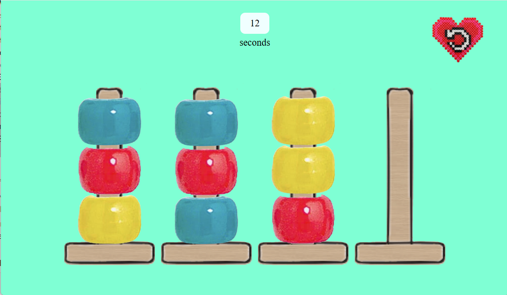

# color stack

## About the Game
A brief description of the game and its objective.

## Getting Started
[Play the Game](https://rahafnabil.github.io/color-stack/)

### How to Play
#### color stack is a game where you initially have randomly stacked colored pieces on a number of sticks (depending on the difficulty of your game), and you need to have all pieces of the same color stacked on top of each other in the same stick, in order to finish a game you must have each of the colors of the game to be in the same stack with the rest of the other pieces of the same color before the countdown timer hits 00:00 
### win case:
player stacks all pieces of the same color each in one stick before countdown reaches 00:00

### lose case:
player doesn't stack all pieces of the same color each in one stick before countdown reaches 00:00

## Technologies Used
- HTML
- CSS
- JavaScript
- images editing tools

## Attributions
- Images and assets: chat gpt

## Next Steps
- more customization
- more defeculties
- leaderboard

